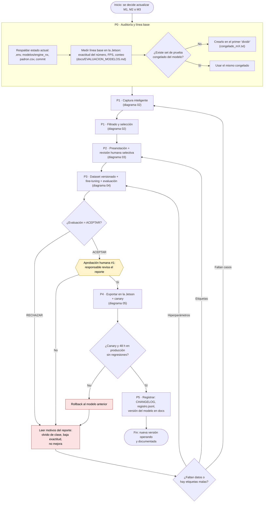
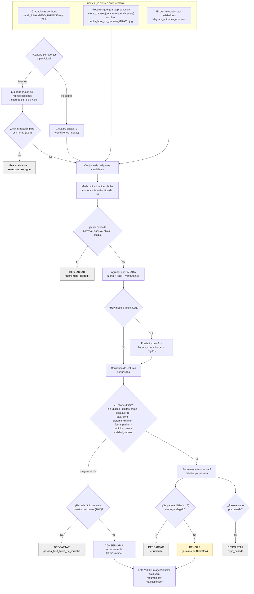
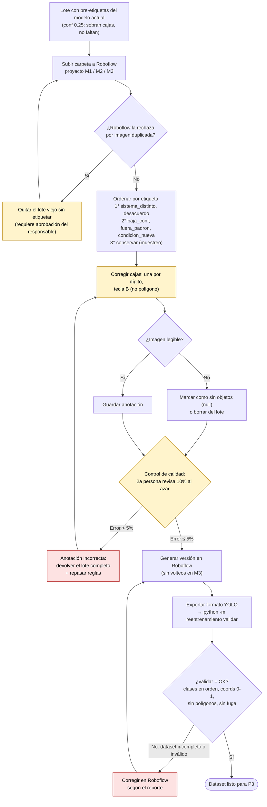
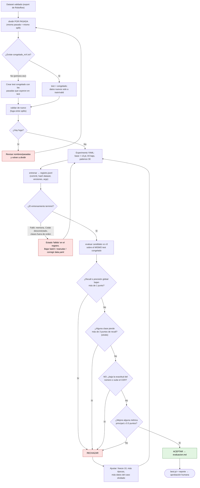
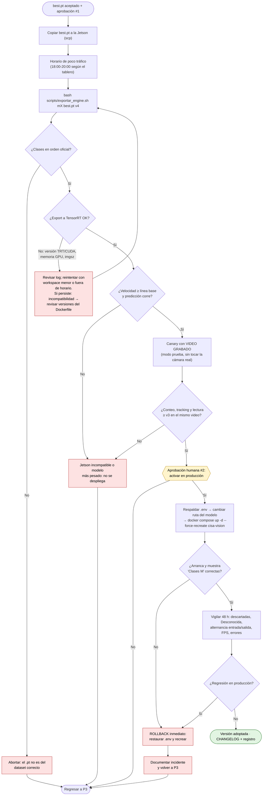

# Diagramas

Los archivos editables están en [`docs/diagramas/`](diagramas/) (formato Mermaid). GitHub los muestra directamente aquí abajo. Para editarlos: [mermaid.live](https://mermaid.live) o la extensión de Mermaid de VS Code.

Colores: **amarillo** = aprobación o trabajo humano · **rojo** = error o retorno para corrección · **verde** = éxito · **gris** = descartado.

## 1. Flujo general (inspección → actualización operativa)

Vista completa con los dos puntos de aprobación humana y los retornos cuando un modelo se rechaza o hay regresión en producción.

Fuente: [`diagramas/01_flujo_general.mmd`](diagramas/01_flujo_general.mmd)

## 2. Captura inteligente, filtrado y selección

Qué pasa con una captura **redundante** (`redundante`, `cupo_pasada`), con **mala calidad** (`mala_calidad:*`), con **baja confianza** (`baja_conf` → revisar) y con un evento sin video.

Fuente: [`diagramas/02_captura_seleccion.mmd`](diagramas/02_captura_seleccion.mmd)

## 3. Preanotación y revisión humana selectiva

Qué pasa con una **anotación incorrecta** (control de calidad, más de 5 % → se devuelve el lote) y con un **dataset incompleto o inválido** (`validar` lo detiene).

Fuente: [`diagramas/03_etiquetado.mmd`](diagramas/03_etiquetado.mmd)

## 4. Dataset, entrenamiento y evaluación

Qué pasa cuando **el entrenamiento falla** (estado `fallido` en el registro) y cuando **el modelo nuevo es peor** (RECHAZAR por regresión global, olvido por clase o exactitud del número).

Fuente: [`diagramas/04_entrenamiento_evaluacion.mmd`](diagramas/04_entrenamiento_evaluacion.mmd)

## 5. Exportación, canary, activación y rollback

Qué pasa cuando **falla la exportación a TensorRT**, cuando **la Jetson es incompatible** (no carga o es lenta) y cuando **hay regresiones en producción** (rollback por `.env`).

Fuente: [`diagramas/05_despliegue_rollback.mmd`](diagramas/05_despliegue_rollback.mmd)

## 6. Diagrama de bloques (arquitectura)

Distinto del flujo: muestra **componentes**, no pasos. Azul = existe; verde punteado = nuevo o propuesto; gris = externo. Explicación de cada bloque en [ARQUITECTURA.md](ARQUITECTURA.md).

Fuente: [`diagramas/06_bloques_arquitectura.mmd`](diagramas/06_bloques_arquitectura.mmd)

```mermaid
%% Diagrama de bloques: arquitectura completa. Línea continua = existe hoy; punteada = propuesto.
%% Clases: existente (azul), propuesto (verde), externo (gris).
flowchart LR
    subgraph FIS["Infraestructura física"]
        CAM["Cámara IP Cam 1<br/>RTSP H.265 Full HD"]
        CAM2["Cámara 2<br/>(opcional, botón Cam 2)"]
        RED["Red del patio<br/>+ Tailscale"]
        JET["Jetson Orin NX Super 16 GB<br/>JetPack 7.2 · CUDA 13.2 · TRT 10.16<br/>disco NVMe 915 GB"]
        COLAB["Google Colab Pro<br/>(GPU de entrenamiento)"]
        DRIVE["Google Drive<br/>CISA_Reentrenamiento/"]
        RF["Roboflow<br/>workspace cisas"]
    end

    subgraph INF["Inferencia en la Jetson (contenedor cisa-vision)"]
        CS["logica/camara.py<br/>CameraStream: GStreamer NVDEC<br/>(FFmpeg de respaldo)"]
        H1["ml/hilos.py · HiloM1<br/>M1 bus_v3.engine + ByteTrack"]
        H2["ml/hilos.py · HiloM2M3<br/>M2 zona (1280) → M3 dígitos"]
        REC["ml/reconocimiento.py<br/>CLAHE, quitar_encimados,<br/>validar_numero, crops"]
        LV["ml/linea_virtual.py<br/>cruce, maniobra, debounce"]
        VAL["avisos/gemini.py + telegram.py<br/>validación (LLM + humano)"]
        WA["cisa-whatsapp<br/>(Node + Baileys)"]
        DB[("PostgreSQL patio_cca<br/>metricas/storage.py")]
        WEB["web/ Flask :5001<br/>tablero, video, API"]
        GRAB["cisa-grabacion<br/>scripts/grabar.sh (72 h)"]
        FS[("Jetson8/<br/>crops_dataset, cisa_frames,<br/>grabaciones, errores")]
    end

    subgraph PROC["Procesamiento para reentrenamiento (reentrenamiento/)"]
        EX["extraer_video.py<br/>por eventos / periódico"]
        CA["calidad.py<br/>nitidez, luz, tamaño"]
        RD["redundancia.py<br/>pasadas + dHash"]
        SE["seleccion.py<br/>conservar / revisar / descartar"]
        PA["preanotacion.py + predicciones.py<br/>lote YOLO con cajas"]
        VE["validar_etiquetas.py<br/>clases, coords, fuga"]
        DV["dividir.py<br/>por pasada + test congelado"]
        EN["entrenar.py<br/>fine-tuning + registro.jsonl"]
        EV["evaluar.py<br/>métricas + ACEPTAR/RECHAZAR"]
    end

    subgraph ADM["Administración"]
        CFG["config.py + .env (producción)<br/>config_reentrenamiento.yaml"]
        REG["experimentos/registro.jsonl<br/>CHANGELOG.md"]
        TST["tests/ (pytest)"]
        EXP["scripts/exportar_engine.sh<br/>+ rollback por .env"]
        SVC["cisa.service (systemd)<br/>arranque al encender"]
        MON["Monitoreo propuesto:<br/>alternancia, descartadas, FPS"]
    end

    CAM -->|RTSP| RED --> CS
    CAM2 -.->|RTSP| CS
    CS -->|"frame BGR"| H1 -->|"cola: frame + buses"| H2
    H2 <--> REC
    H2 --> LV
    LV -->|"cruce + número"| VAL --> DB
    VAL --> WA
    DB --> WEB
    REC -->|"jpg"| FS
    RED --> GRAB -->|"mp4/h"| FS
    SVC --> CS

    FS -.->|"scp / Drive"| DRIVE
    WEB -.->|"JSON eventos"| EX
    DRIVE -.-> EX
    EX -.-> CA -.-> RD -.-> SE -.-> PA
    PA -.->|"lote YOLO"| RF
    RF -.->|"export YOLO"| VE -.-> DV -.-> EN -.-> EV
    COLAB -.-> EN
    EV -.->|"best.pt aceptado"| EXP -.->|".engine FP16"| JET
    EN -.-> REG
    CFG --> H1
    TST -.-> PROC
    MON -.-> DB

    classDef existe fill:#E3F0FF,stroke:#1F5FAD,color:#000;
    classDef propuesto fill:#E2F5E2,stroke:#2E7D32,color:#000,stroke-dasharray: 5 3;
    classDef externo fill:#F0F0F0,stroke:#777,color:#000;
    class CS,H1,H2,REC,LV,VAL,WA,DB,WEB,GRAB,FS,CFG,SVC existe;
    class EX,CA,RD,SE,PA,VE,DV,EN,EV,REG,TST,EXP,MON propuesto;
    class CAM,CAM2,RED,JET,COLAB,DRIVE,RF externo;
```

